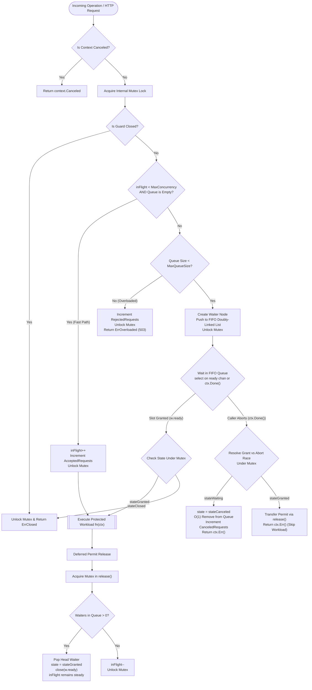

# GoLoadGuard

[](https://golang.org)
[](LICENSE)
[](#supported-ecosystems)
[](#core-design-principles)
[](#verified-benchmarks)
[](#the-shared-hosting-breakthrough)

> **Universal In-Process Concurrency Management, Bounded FIFO Queuing, and Anti-OOM Backpressure Protection across Go, Node.js, NestJS, PHP, and Laravel.**

---

> [!TIP]
> **Looking for installation, framework setup, and configuration?**
> Detailed step-by-step installation guides, code snippets for Go, Express, NestJS, and Laravel, plus production deployment instructions can be found in **[PROJECT-SETUP.md](PROJECT-SETUP.md)**.

---

## 📑 Table of Contents
1. [Overview & Problem Statement](#overview--problem-statement)
2. [What GoLoadGuard Does](#what-goloadguard-does)
3. [Core Architecture](#core-architecture)
4. [Internal Request Lifecycle Flow](#internal-request-lifecycle-flow)
5. [Core Algorithms & Techniques](#core-algorithms--techniques)
6. [Why These Techniques Were Chosen](#why-these-techniques-were-chosen)
7. [The Shared Hosting Breakthrough](#the-shared-hosting-breakthrough)
8. [Project Structure](#project-structure)
9. [Design Decisions](#design-decisions)
10. [Alternatives & Comparison Matrix](#alternatives--comparison-matrix)
11. [Verified Benchmarks](#verified-benchmarks)
12. [Use Cases](#use-cases)
13. [Limitations & Trade-offs](#limitations--trade-offs)
14. [Implementation & Setup Reference](#implementation--setup-reference)
15. [License](#license)

---

## Overview & Problem Statement

### The Problem: Goodput Collapse & The OOM Death Spiral

Under unexpected traffic spikes or downstream bottlenecks (such as slow database queries, disk I/O freezes, or third-party API lag), modern web runtimes (`net/http`, Node.js Event Loop, PHP-FPM) greedily accept incoming TCP connections.

When requests arrive faster than the application can process them, server latency balloons exponentially:

```
[Normal Operation]   Traffic: 200 req/s  ──► Latency: 25ms    ──► Goodput: 200 req/s (100% Useful)
[Unbounded Overload] Traffic: 3,000 req/s ──► Latency: 9,500ms ──► Goodput: 0 req/s   (TOTAL OUTAGE)
```

### Why Uncontrolled Queuing Destroys Systems:
1. **Unbounded Memory Bloat**: Hundreds or thousands of stalled requests hoard memory buffers, context objects, and database connections.
2. **Cascading Client Timeouts**: Modern clients and API gateways configure timeouts (e.g., 2–3 seconds). When a request waits 6 seconds inside an internal runtime queue before even starting execution, the server spends precious CPU cycles completing work for a connection that has **already been closed** by the client.
3. **Goodput Collapse**: The server reports 100% CPU and memory utilization, yet delivers **zero usable HTTP responses** to actual users.
4. **Kernel Termination**: On Linux VPS and Docker containers, the Linux kernel invokes the `OOM-Killer` (`SIGKILL 137`). On cPanel and CloudLinux shared hosting, the system triggers `508 Resource Limit Reached` due to Entry Process (EP) exhaustion.

### Traditional Rate Limiters Do Not Prevent Overload
Traditional rate limiters (Token Bucket, Leaky Bucket) only restrict request frequency over a fixed time period (e.g., 100 requests per minute). They are blind to **execution duration**. If 20 complex reporting queries are running simultaneously, a rate limiter permits more incoming requests even if database pool saturation is causing a total system lockup.

**GoLoadGuard solves this by governing concurrent in-flight workload at the gate.**

---

## What GoLoadGuard Does

GoLoadGuard enforces a strict **Two-Tier Admission Control Gate** directly in-process:

1. **Permit Admission**: Allows up to `MaxConcurrency` operations to execute simultaneously.
2. **Deterministic Bounded FIFO Queue**: Queues up to `MaxQueueSize` waiting requests in exact first-in, first-out order.
3. **Immediate Fast-Fail (Backpressure)**: When both active slots and queue capacity are saturated, incoming requests are rejected immediately with `ErrOverloaded` (`503 Service Unavailable` with `Retry-After` header) in **zero memory allocations** and **under 35 nanoseconds**.
4. **Zero Permit Leaks**: Resolves race conditions when caller contexts or HTTP sockets abort while waiting in queue or during permit handoff.
5. **Zero External Infrastructure**: Operates 100% in-process without requiring Redis, Memcached, Consul, or separate background daemons.

---

## Core Architecture

GoLoadGuard is built around an explicit state machine and an internal doubly-linked queue, protected by fine-grained synchronization:



---

## Internal Request Lifecycle Flow

Every call through `guard.Do(ctx, fn)` undergoes an 8-stage lifecycle:

```text
Stage 1: Context Pre-Check
         Verify ctx.Err() == nil before touching any locks.

Stage 2: Mutex Acquisition & Closed Check
         Acquire guard.mu. If closed, increment ClosedRejections and return ErrClosed.

Stage 3: Fast-Path Evaluation
         If inFlight < MaxConcurrency AND waiter queue is empty:
         Increment inFlight, increment AcceptedRequests, unlock mutex, proceed to Stage 7.

Stage 4: Bounded Backpressure Gate
         If queue length >= MaxQueueSize:
         Increment RejectedRequests, unlock mutex, immediately return ErrOverloaded.

Stage 5: Doubly-Linked Waiter Enqueue
         Allocate a waiter node with an unbuffered ready channel.
         Push node to tail of doubly-linked list. Unlock mutex.

Stage 6: Synchronous Block & Race Resolution
         select blocks on w.ready channel or caller ctx.Done().
         If context cancels:
           - If waiter still in stateWaiting: unbind node from list in O(1) time.
           - If permit was already granted (stateGranted): call release() to hand off permit.

Stage 7: Workload Execution
         Execute user function fn(ctx) protected by defer release().
         If fn panics, defer guarantees permit release without leakage.

Stage 8: Permit Handoff / Decrement
         In release(): pop the head waiter from FIFO queue and wake it via channel close.
         If no waiters remain, decrement inFlight.
```

---

## Core Algorithms & Techniques

### 1. Pointer-Based Doubly-Linked FIFO Queue
- **Implementation**: `waiterQueue` struct maintaining `head`, `tail`, and `len` with explicit `prev` and `next` pointers.
- **Why It Matters**: Standard slices or channels do not support efficient arbitrary removals. When a client cancels an HTTP request while waiting in queue, GoLoadGuard unlinks the waiter node from the list in **$O(1)$ time without memory reallocation or array shifting**.

### 2. State-Machine Waiter Model
- **Implementation**: Each queued waiter has a discrete terminal state: `stateWaiting`, `stateGranted`, `stateCanceled`, or `stateClosed`.
- **Why It Matters**: Prevents duplicate permit allocation and guarantees that a cancellation event and a grant event arriving simultaneously on different CPU cores resolve deterministically under the mutex.

### 3. Post-Grant Cancellation Contract
- **Implementation**: If a permit is granted to a waiter whose context was canceled concurrently, GoLoadGuard detects this state, skips execution of `fn(ctx)`, and automatically invokes `release()` to pass the slot forward to the next legitimate waiter.

### 4. Zero-Allocation Fast Path
- **Implementation**: In uncontended execution, when `inFlight < MaxConcurrency`, the admission path does not allocate any heap objects or closures.
- **Why It Matters**: Verified by Go benchmarks at **0 B/op** and **0 allocs/op**, ensuring zero garbage collection overhead on high-throughput microservices.

### 5. Multi-Runtime Socket Lifecycle Protection (Node.js)
- **Implementation**: Listens to `res.on('finish')`, `res.on('close')`, `req.on('close')`, and socket error events.
- **Why It Matters**: Ensures that if a client terminates an HTTP connection midway, the permit slot is immediately reclaimed, completely preventing permit leakage in event-loop environments.

### 6. Atomic Kernel Locks with Stale Lease Reclamation (PHP)
- **Implementation**: Uses POSIX `flock(LOCK_EX | LOCK_NB)` on scoped `/tmp` lockfiles. Periodically inspects registered PID liveness via `posix_kill($pid, 0)` and timestamp timeouts.
- **Why It Matters**: Enables multi-process concurrency control across separate PHP-FPM / Apache worker processes on shared hosting with zero external daemons, automatically recovering orphaned slots if a PHP script crashes unexpectedly.

---

## Why These Techniques Were Chosen

| Technical Requirement | Chosen Technique | Alternative Rejected | Reason for Decision |
| :--- | :--- | :--- | :--- |
| **Queue Management** | Doubly-Linked List (`*waiter`) | Go Buffered Channel (`chan struct{}`) | Channels cannot remove a canceled item from the middle of the buffer. |
| **Concurrency Sync** | `sync.Mutex` + Atomic Counters | Atomics Only (CAS Loop) | Mutex provides deterministic coordination between queue state and in-flight counters. |
| **Fast-Fail Defense** | Synchronous Gate Check | Asynchronous Worker Pool | Spawning goroutines or worker pools under overload consumes extra memory; synchronous rejection costs zero memory. |
| **PHP Multi-Process** | Kernel `flock` + File Descriptors | Redis / Memcached | Shared hosting and cPanel accounts do not provide root access or persistent Redis instances. |

---

## The Shared Hosting Breakthrough

Running concurrency control in shared hosting environments (cPanel, CloudLinux, LiteSpeed, Apache mod_php) has traditionally been impossible due to severe environment constraints:
1. `disable_functions` in `php.ini` blocks `exec()`, `shell_exec()`, and `proc_open()`.
2. CloudLinux kills persistent background daemons and caps Entry Processes (EP) to 20–30.
3. Shared accounts lack Redis, Memcached, or root privileges.

### How GoLoadGuard Overcomes This:
- **Zero Daemon**: Requires no background process running.
- **Zero Subprocess**: Executes 100% within pure PHP userland.
- **Atomic File Locks**: Employs kernel-level non-blocking file locking (`flock`) in `/tmp` or `storage/framework/`.
- **Application Scope Hashing**: Namespaces lockfiles by hashing application directory paths, ensuring isolation between independent accounts on shared servers.
- **Kernel Auto-Reclaim**: If a PHP script crashes or is terminated by CloudLinux, the Linux kernel automatically unbinds OS file descriptors.

---

## Project Structure

```text
GoLoadGuard/
├── guard.go                  # Core admission engine (Do, acquire, release, Close, Stats)
├── queue.go                  # Doubly-linked FIFO queue with O(1) Push, PopHead, and Remove
├── config.go                 # Configuration schema and boundary validation
├── stats.go                  # Runtime metrics snapshot (in-flight, queue size, rejections)
├── errors.go                 # Sentinel error definitions (ErrOverloaded, ErrClosed, etc.)
├── doc.go                    # Go package documentation
├── guard_test.go             # Unit tests for concurrency limits, FIFO order, and panics
├── cancellation_test.go      # Edge case tests for context cancellation and races
├── benchmark_test.go         # Allocation and latency benchmark suites
├── httpguard/                # Standard Go net/http middleware
│   ├── middleware.go         # HTTP handler wrapper with automated 503 & Retry-After
│   └── middleware_test.go    # HTTP integration tests
├── packages/
│   ├── node/                 # Pure TypeScript / Node.js implementation
│   │   ├── src/index.ts      # LoadGuard class, expressMiddleware, loadGuardMiddleware
│   │   ├── src/nest.guard.ts # NestJS CanActivate guard provider
│   │   └── test/guard.test.js# Node.js regression & socket leak test suite
│   └── php/                  # Universal PHP / Laravel implementation
│       └── src/
│           ├── Guard.php     # Pure PHP engine with flock & stale lease recovery
│           └── Laravel/      # Laravel Middleware & ServiceProvider
└── .github/workflows/ci.yml  # Multi-runtime automated CI pipeline (Go, Node, PHP)
```

---

## Design Decisions

### 1. In-Process vs. Distributed Lock (Redis)
- **Decision**: GoLoadGuard operates entirely in-process per application instance.
- **Rationale**: An in-process lock executes in nanoseconds (`~33ns`) with zero network overhead. Redis locks require roundtrip network latency (1–5ms), consume TCP sockets, and introduce an external point of failure.

### 2. Deterministic Bounded Queuing vs. Unbounded Buffers
- **Decision**: All queues have an explicit `MaxQueueSize` limit; requests exceeding this limit fail instantly.
- **Rationale**: Unbounded queues simply convert CPU overload into memory exhaustion, ultimately triggering an unrecoverable crash.

### 3. Immediate Fast-Fail with Retry-After
- **Decision**: Dropped requests receive `503 Service Unavailable` with a configurable `Retry-After` header.
- **Rationale**: Signaling backpressure allows upstream proxies (Cloudflare, Nginx, ALB) and client libraries to back off exponentially instead of retrying indiscriminately.

---

## Alternatives & Comparison Matrix

| Capability | Standard Semaphore (`x/sync/semaphore`) | Token Bucket / Leaky Bucket | Netflix Concurrency Limits | **GoLoadGuard** |
| :--- | :--- | :--- | :--- | :--- |
| **In-Flight Concurrency Control** | ✅ Yes | ❌ No (Rate only) | ✅ Yes | ✅ **Yes** |
| **Strict Bounded Queue Capacity** | ❌ No (Unbounded) | ❌ No | ⚠️ Heuristic | ✅ **Deterministic Bounded** |
| **Zero Memory Allocation on Fast-Path** | ❌ Spawns channel waiters | ⚠️ Struct allocations | ❌ Heavy object allocations | ✅ **0 B/op, 0 allocs/op** |
| **O(1) Cancellation Unlinking** | ❌ Not supported | N/A | ❌ Complex race cleanup | ✅ **O(1) Doubly-Linked List** |
| **Post-Grant Race Protection** | ❌ Prone to permit leaks | N/A | ⚠️ Complex recovery | ✅ **Deterministic Mutex State** |
| **External Dependencies** | ✅ None | ✅ None | ❌ Heavy dependencies | ✅ **Zero (Standard Library)** |
| **Supported Ecosystems** | Go only | Language-specific | Java / Go only | ✅ **Go, Node, Nest, PHP, Laravel** |
| **cPanel / Shared Hosting Support** | ❌ No | ❌ In-memory only | ❌ No | ✅ **100% Native flock Support** |

---

## Verified Benchmarks

The Go engine was tested under uncontended and heavily contended parallel execution on an Intel Core i3-10100 CPU @ 3.60GHz running 64-bit Windows:

```bash
go test -bench=Benchmark -benchmem -count=1 .
```

### Verified Benchmark Results:

| Benchmark Case | Iterations Completed | Latency | Memory Allocation | Heap Allocs |
| :--- | :--- | :--- | :--- | :--- |
| **`BenchmarkUncontended-8`** | **36,272,395 ops** | **33.26 ns/op** | **0 B/op** | **0 allocs/op** |
| **`BenchmarkConcurrentContention-8`** | **12,945,974 ops** | **93.79 ns/op** | **0 B/op** | **0 allocs/op** |

> [!NOTE]
> In both uncontended and high-concurrency parallel environments, the fast admission path requires **zero heap allocations**, guaranteeing zero impact on Go's garbage collector.

---

## Use Cases

1. **Database Connection Shielding**: Restricting API route execution to match database pool capacity (e.g., maximum 20 concurrent queries), preventing connection exhaustion.
2. **CPU-Intensive Tasks**: Throttling heavy PDF generation, image resizing, or cryptography operations to the number of available CPU cores.
3. **Shared Hosting / cPanel Protection**: Enforcing limits on PHP/Laravel applications to keep concurrent workers below CloudLinux Entry Process caps (`508 Resource Limit Reached`).
4. **Third-Party Rate Limit Compliance**: Protecting outbound workers calling payment gateways or external SaaS APIs from exceeding upstream concurrency limits.
5. **Microservice Resilience**: Preventing cascading failures across distributed microservices by failing fast when downstream services become unresponsive.

---

## Limitations & Trade-offs

1. **In-Process Scope (Go & Node.js)**: Concurrency limits apply per process instance. In multi-container or clustered deployments, the effective system concurrency is `MaxConcurrency * Number of Instances`.
2. **PHP Filesystem Lock Boundary**: PHP uses kernel-level `flock` on local storage (`/tmp` or `storage/`). In horizontally scaled clusters across multiple separate virtual servers without a shared clustered filesystem, each server manages its local concurrency independently.
3. **Queue Wait Latency**: A caller queued behind `MaxConcurrency` busy tasks will experience latency proportional to the duration of those tasks. Use `context.WithTimeout` (Go), `queueTimeoutMs` (Node.js), or timeout options (PHP) to prevent indefinite waiting.

---

## Implementation & Setup Reference

For complete installation steps, framework configuration, and deployment guidelines, refer to **[PROJECT-SETUP.md](PROJECT-SETUP.md)**:

| Section | Focus Area | Direct Link |
| :--- | :--- | :--- |
| **Go Native & HTTP** | Setup `goloadguard.New` and `httpguard.Middleware` | [Go Setup](PROJECT-SETUP.md#1-go-golang-setup) |
| **Node.js & Express** | Setup `loadGuardMiddleware` and `expressMiddleware` | [Node.js Setup](PROJECT-SETUP.md#2-nodejs--express-setup) |
| **NestJS** | Setup `NestLoadGuard` provider and controller decorator | [NestJS Setup](PROJECT-SETUP.md#3-nestjs-setup) |
| **PHP Native** | Setup `Guard::run` with atomic file locking | [PHP Native Setup](PROJECT-SETUP.md#4-php-native-setup) |
| **Laravel Framework** | Register `LoadGuardMiddleware` globally or on routes | [Laravel Setup](PROJECT-SETUP.md#5-laravel-framework-setup) |
| **Configuration Schema** | Full parameters reference table | [Configuration Reference](PROJECT-SETUP.md#configuration-reference) |
| **Production Deployment** | Docker, Linux VPS, Nginx, and cPanel configuration | [Deployment Guidelines](PROJECT-SETUP.md#production-deployment--tuning) |

---

## License

This project is licensed under the [MIT License](LICENSE).
