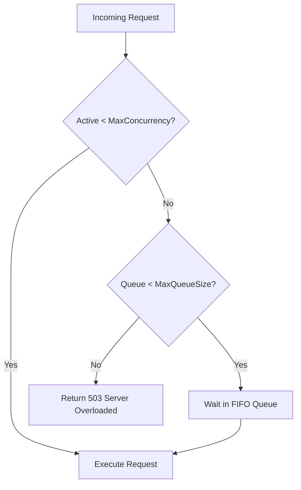

# GoLoadGuard

[](https://golang.org)
[](LICENSE)
[](#quick-start)

> **Protect your backend from crashing under heavy traffic. Limits concurrent requests and queues waiting users in first-in, first-out (FIFO) order. Works with Go, Node.js, NestJS, PHP, and Laravel.**

---

## ⚡ The Problem: Why Servers Crash

When a sudden spike of 2,000 requests hits your server:
1. Normal web servers greedily accept every single request.
2. The database connection pool gets exhausted and queries slow down.
3. Memory spikes and the server runs out of RAM (OOM Crash / Error 508 on cPanel).

**GoLoadGuard fixes this:**
- Sets a strict limit on active tasks (e.g. max 20).
- Holds extra requests in an orderly FIFO queue.
- If the queue is also full, immediately replies with `503 Service Unavailable` so the server never crashes.

---

## 🚀 Quick Start

### In Go
```go
package main

import (
    "context"
    "fmt"
    "net/http"
    "github.com/Zihad-Bepari/GoLoadGuard"
    "github.com/Zihad-Bepari/GoLoadGuard/httpguard"
)

func main() {
    // Max 20 concurrent requests, max 50 waiting in queue
    guard, _ := goloadguard.New(goloadguard.Config{
        MaxConcurrency: 20,
        MaxQueueSize:   50,
    })

    mux := http.NewServeMux()
    mux.HandleFunc("/api/heavy", func(w http.ResponseWriter, r *http.Request) {
        fmt.Fprintln(w, "Processed safely!")
    })

    // Protect all routes with middleware
    handler := httpguard.Middleware(guard)(mux)
    http.ListenAndServe(":8080", handler)
}
```

### In Node.js (Express)
```javascript
const express = require('express');
const { loadGuardMiddleware } = require('@goloadguard/node');

const app = express();

// Protect all routes against traffic spikes
app.use(loadGuardMiddleware({ maxConcurrency: 20, maxQueueSize: 50 }));

app.get('/api/orders', (req, res) => {
  res.json({ message: 'Order processed safely' });
});

app.listen(3000);
```

### In NestJS
```typescript
import { Controller, Get, UseGuards } from '@nestjs/common';
import { LoadGuard } from '@goloadguard/node';
import { NestLoadGuard } from '@goloadguard/node/dist/nest.guard';

const guard = new LoadGuard({ maxConcurrency: 15, maxQueueSize: 30 });

@Controller('orders')
export class OrdersController {
  @Get()
  @UseGuards(new NestLoadGuard(guard))
  getOrders() {
    return { status: 'success' };
  }
}
```

### In Laravel
In `routes/api.php` or controller:
```php
use Illuminate\Support\Facades\Route;

// Protect route: max 20 concurrent, queue 50
Route::middleware('loadguard:20,50')->get('/orders', function () {
    return response()->json(['status' => 'success']);
});
```

---

## 📐 How It Works



---

## 📖 Full Documentation

For full setup guides, configuration tables, and framework integration:
👉 **[Read the complete Project Setup Guide (PROJECT-SETUP.md)](PROJECT-SETUP.md)**

---

## 📄 License

MIT License — Copyright (c) 2026 Zihad Bepari.
